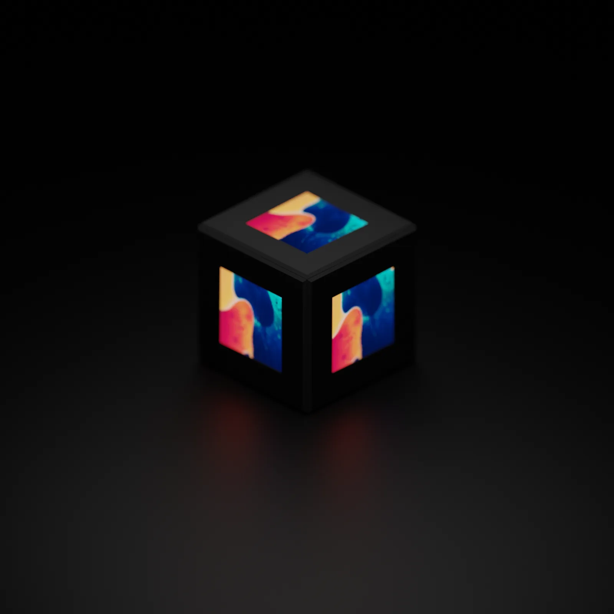
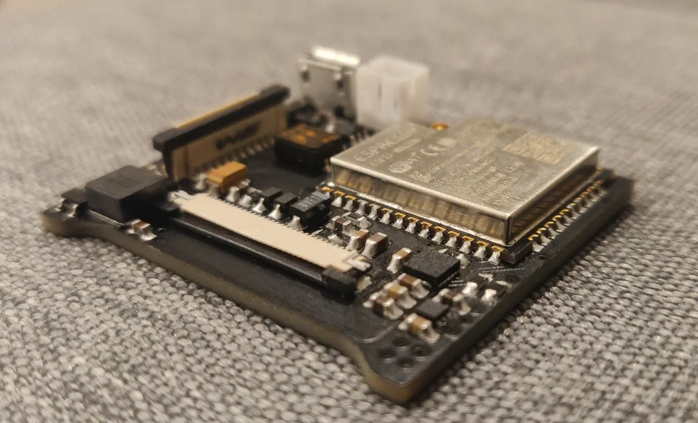
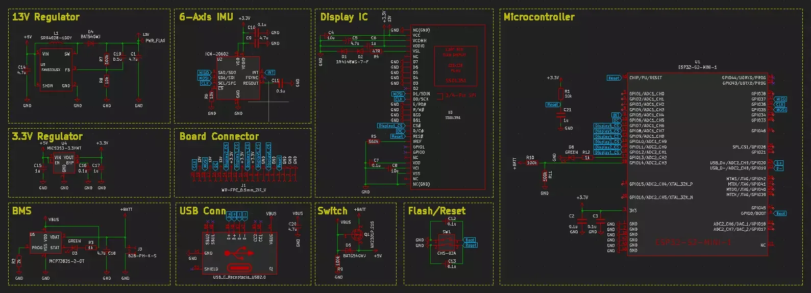
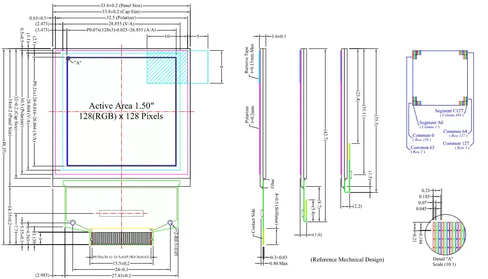
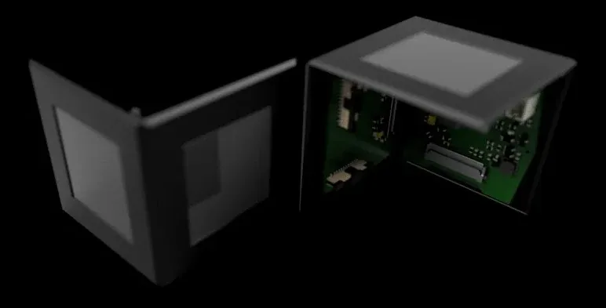
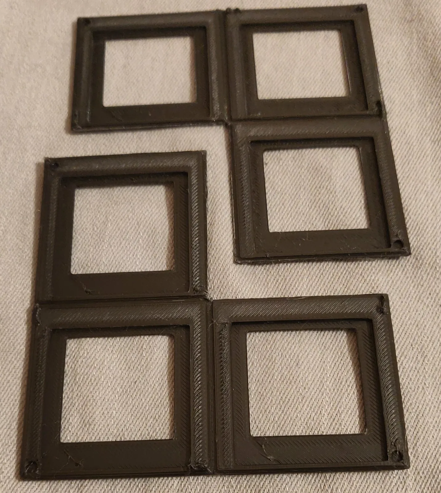
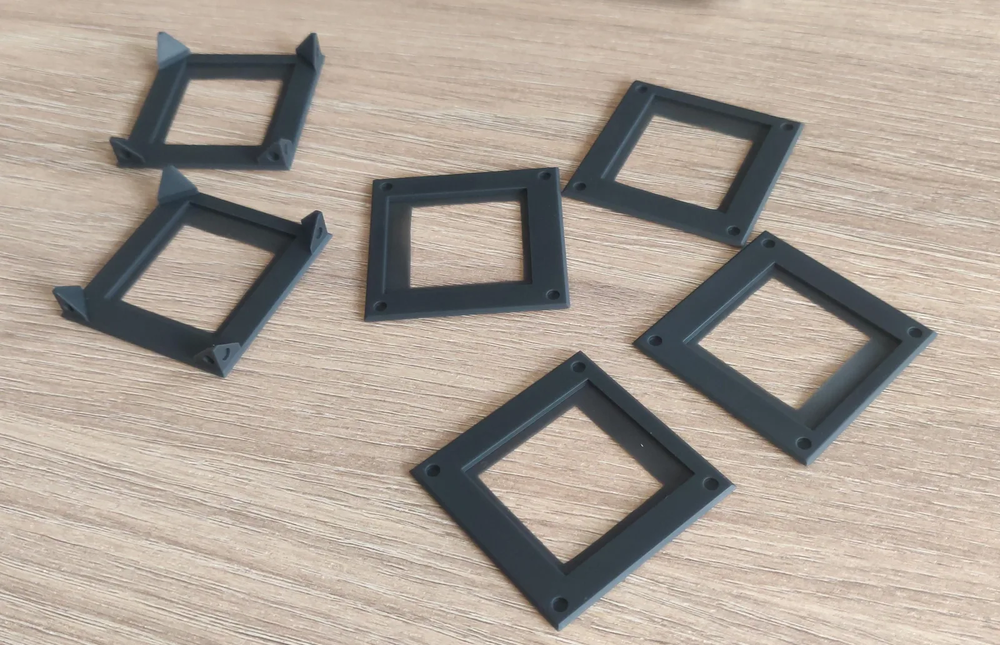
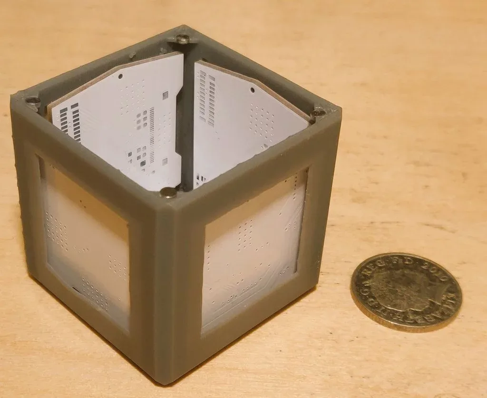

# CUBE

CUBE is a miniature, six-faced OLED display cube built from a stack of custom interconnected PCBs. The current design combines an ESP32-S2 motherboard, five further display boards, a magnet-held 3D-printed frame and bring-up firmware for SPI displays and motion sensing.



## Overview

CUBE is a handheld, self-contained display object rather than a conventional LED matrix. Each of its six faces carries a 1.5-inch, 128×128 RGB OLED module driven by an SSD1351 controller, giving 98,304 addressable pixels across the cube. The aim is to make a small object whose faces can show independent graphics and respond to movement, while remaining easy to open, charge and repair.

The project began in December 2021 after seeing Greg Davill's [miniature LED cube](https://gregdavill.com/blog/2020/6/13/miniature-3456x-led-cube) and Pol Pla's research on [Display Blocks](https://dam-prod.media.mit.edu/x/files/sites/default/files/TEI_DisplayBlocks_CameraReady_lite.pdf). Both demonstrated the appeal of a compact, tactile display device. CUBE takes that idea in a different direction: instead of an FPGA and an LED matrix, it uses a microcontroller, six square OLED modules and a modular PCB-and-frame construction.

**Status:** design-stage prototype. The repository records work from December 2021 to May 2022. It contains the electrical and mechanical design files, photographs of a fabricated motherboard and several printed frame prototypes, and display and IMU bring-up sketches. The final assembled cube and an integrated application firmware are not present.

## Features

- **Six active faces:** one 128×128 RGB OLED on the motherboard and one on each of the five display boards.
- **Shared SPI display bus:** all six SSD1351 displays share clock, data and data/command lines, with a separate chip-select line for each face.
- **Daisy-chained construction:** 20-way, 0.5 mm pitch flat flexible cables carry power and SPI between boards, allowing the cube to be unfolded for assembly and servicing.
- **ESP32-S2 motherboard:** native USB, external-antenna module footprint, ICM-20602 six-axis IMU, USB-C input, LiPo charger with load sharing, 3.3 V regulation and a 13 V boost converter for the OLEDs.
- **Modular display boards:** D2–D6 each carry one display, two FFC connectors and the necessary decoupling and termination. The repeated design allows a single side to be revised independently later.
- **Magnet-held frame:** FreeCAD models and STEP/STL exports for the enclosure, using 3 mm neodymium magnets to join printed panels.
- **Bring-up software:** Arduino sketches that test one display at a time up to six displays, exercise the Adafruit GFX drawing primitives, and demonstrate IMU orientation output.

## Technologies

- **KiCad:** schematic capture, PCB layout and fabrication outputs. D1 uses the KiCad 6 project format; D2–D6 use the earlier `.sch` and `.pro` format.
- **ESP32-S2:** the ESP32-S2-MINI-1U supplies the processing, Wi-Fi, native USB and external-antenna option.
- **SSD1351 and Adafruit GFX:** display driver and graphics library used by the OLED modules and test sketches.
- **C/C++ with the Arduino framework:** firmware bring-up sketches for the displays and IMU.
- **FreeCAD:** mechanical design of the frame, including the panel and magnet layouts.
- **Blender:** rendered presentation of the assembled cube.
- **JLCPCB:** SLA 3D printing service used for the individual frame panels.

## Gallery



*The assembled motherboard, showing the ESP32-S2 module, USB-C connector, battery connector, FFC connector and power circuitry.*



*Motherboard schematic sheets covering the 13 V and 3.3 V supplies, battery management, USB input, IMU, display interface and ESP32-S2.*



*Mechanical reference for the 1.5-inch, 128×128 RGB OLED module, including its active area, bezel and FFC tail.*



*Two frame halves with the PCB assembly test-fitted inside.*



*An early FDM-printed frame, printed flat and folded like origami to avoid overhangs.*



*Individual SLA-printed panels with magnet pockets, produced through JLCPCB's 3D printing service.*



*A PCB and display test-fitted into a printed frame panel.*

## Technical Details

### System architecture

CUBE is built from six boards arranged as the faces of a cube. D1 is the motherboard and also carries one display. D2–D6 are display boards with the same electrical function: each accepts the incoming bus, drives one OLED and passes the bus to the next face. The boards are approximately 38 mm across and use two copper layers. The FreeCAD frame envelope is approximately 52 mm cubed.

The interconnect is a 20-way, 0.5 mm pitch FFC bus. It carries the shared SPI clock and data lines, the data/command line, 3.3 V, the 13 V OLED supply, ground and the chip-select lines that have not yet been consumed. D1 uses one select locally and forwards five to D2. Each subsequent board consumes one select and forwards the remainder, so the number of active select lines decreases along the chain until, in the intended design, D6 receives the final line. Because every display has its own chip-select, the microcontroller can update one face without disturbing the others.

### Motherboard

The motherboard is built around an ESP32-S2-MINI-1U. The module's native USB interface removes the need for a separate USB-to-UART bridge, reducing component count and board area. The 1U variant was selected for its external-antenna option.

The main subsystems are:

- **Power input and battery management:** a USB-C receptacle feeds a MCP73831 LiPo charger. A P-channel MOSFET and Schottky diode provide load sharing between USB and battery power. A 2-pin JST PH connector accepts the battery.
- **Regulation:** a MIC5353 provides the 3.3 V rail, while a FAN5331 boost converter generates the 13 V bias required by the OLED modules.
- **Sensing:** an ICM-20602 accelerometer and gyroscope share the SPI bus and provide an interrupt output.
- **Display interface:** a 20-pin FFC connector distributes the bus to the first display board. The motherboard also carries one SSD1351 display module on its top face.
- **Control and status:** a two-way DIP switch provides boot and reset control, and green LEDs indicate power and charger status.

### Display boards

D2–D6 share the same basic layout and component set, although the chip-select wiring changes along the chain. Each board contains one 1.5-inch 128×128 SSD1351 OLED module, two 20-pin FFC connectors for the daisy chain, decoupling capacitors and series components for the display signals. There is no local microcontroller; all rendering is performed by the ESP32-S2 and sent over the shared bus.

The D6 directory currently contains copies of the D5 files, including the D5 chip-select assignment. This is a known naming and versioning artefact: D6 is intended to be the sixth display face, and the duplicate was left in place so that a single side could be modified later without changing the other four. Before D6 can act as the sixth face, its netlist needs to be changed to consume only `Display6_CS`.

### Mechanical design

The enclosure was developed in FreeCAD and exported as STEP and STL files. The frame is approximately 52 mm cubed and uses 3 mm neodymium magnets to hold its sections together so that the cube can be opened for charging or repair. The repository includes the FreeCAD source, the six wall panels, a compound assembly and several earlier design iterations in `Hardware/Frame/OLD`.

Three fabrication approaches were explored:

1. **FDM-printed folded frame:** the panels were printed flat in ABS and folded like origami. This avoided overhangs and produced a smooth outer surface, but the print quality and tolerances were not good enough for a finished object.
2. **Single-piece SLA lid:** an SLA print gave a better surface finish, but the material was brittle and chipped during support removal. Placing PCBs into a frame with five connected panels was also difficult.
3. **Individual magnet panels:** each panel was printed separately through JLCPCB's SLA service, allowing the PCBs and displays to be fitted easily. The finish was the best of the three, but the resulting frame was fragile when pressure was applied to opposite corners, and gluing the many magnets was slow and error-prone.

The design direction recorded in the project notes is a final frame made from two evenly sized three-sided sections, printed in SLA, with improved magnet pockets. Keeping each section to three sides makes assembly easier while still allowing the cube to be opened.

### Firmware and bring-up

The software is a collection of Arduino sketches rather than a finished application. The sequence in `Software/Display/Testing` progresses from a single display to test routines for all six faces. `1_Display_SW` initialises one display, and the later sketches add calls for more faces. The progression is not fully consistent: `3_Display_SW` initialises OLED4 but not OLED3, while `5_Display_SW` and `6_Display_SW` call drawing routines on the fifth and sixth displays without calling `begin()` on those objects. The sketches use software SPI with the following pins:

| Signal | GPIO |
| --- | --- |
| SCLK | 36 |
| MOSI | 35 |
| DC | 5 |
| CS 1 | 6 |
| CS 2 | 12 |
| CS 3 | 14 |
| CS 4 | 18 |
| CS 5 | 17 |
| CS 6 | 11 |

The display sketches use the Adafruit GFX drawing API and the Adafruit SSD1351 driver. The vendored driver files in `Software/Display/lib` have been renamed to `Multi_SSD1351`, but the source still includes `Adafruit_SSD1351.h`; the upstream Adafruit SSD1351 library should therefore be installed when building the sketches.

The IMU sketches in `Software/IMU` use an MPU6050 and Jeff Rowberg's DMP library over I2C. They print yaw, pitch and roll over serial for orientation experiments, but they do not drive the ICM-20602 fitted to the motherboard. An ICM-20602 SPI driver and the integration between sensing, rendering and power management remain to be written.

## Challenges and Solutions

### Driving six displays from one bus

Six displays could not each have a dedicated SPI peripheral, and duplicating the bus would have added wiring and pins. The chosen approach shares clock, data and data/command lines while giving every display its own chip-select. Each board consumes one select line and passes the unused lines to the next board, so the ESP32-S2 can still address any face individually without carrying all six selects to the end of the chain. The staged one-to-six test sketches provide an incremental validation path for this arrangement.

### Sourcing a suitable square display

Small, high-resolution square OLED modules are uncommon. The available 1.5-inch 128×128 SSD1351 modules have relatively large bezels, which limits the visible area of each face. The design accepts this trade-off because the modules are readily available, have an integrated controller and use a simple SPI interface. Smaller square OLEDs may become easier to source as the VR and wearable markets grow.

### Producing a repeatable frame

Each frame process exposed a different limitation: FDM printing gave poor surface finish and tolerances, SLA printing was brittle and difficult to clean up, and individual magnet panels were fragile under diagonal loads. The current design direction is two three-sided SLA sections with improved magnet pockets, balancing print quality, ease of assembly and serviceability. The prototype frames in the repository are development iterations, not the final enclosure.

### Reducing component count

An early constraint was fitting the electronics into a small cube. The ESP32-S2's native USB removed the USB-to-UART bridge and its associated circuitry, and the ESP32-S2-MINI-1U provided the processing and wireless capability in a small module. The remaining power path was kept modular: USB-C input, a LiPo charger with load sharing, a 3.3 V rail and a dedicated 13 V boost for the displays.

## Results and Validation

The repository contains evidence of the following work:

- A fabricated D1 motherboard, photographed and shown test-fitted in a frame assembly.
- KiCad schematics and PCB layouts for the motherboard and display boards.
- Printed frame prototypes, including folded FDM frames, SLA panels and a PCB test fit.
- Staged display sketches that progress from one display to calls for six faces and exercise drawing primitives.
- An IMU orientation sketch using the MPU6050 DMP library.

There is no automated test suite, no captured frame-rate or power-consumption measurements, and no integrated application firmware in this repository. The final cube has not been assembled from the final frame design.

Known limitations:

- D6 duplicates the D5 hardware files, including the D5 chip-select wiring, and is not independently versioned.
- Several sketches omit `begin()` calls: `3_Display_SW` does not initialise OLED3, and `5_Display_SW` and `6_Display_SW` do not initialise the fifth and sixth display objects.
- The vendored SSD1351 driver is renamed but retains the upstream include name.
- The IMU sketch targets the MPU6050, while the motherboard uses the ICM-20602.
- The final two-part SLA frame and the integrated firmware are still outstanding.

## Getting Started

### Prerequisites

- KiCad 6 or newer to open the D1 project; the D2–D6 boards use the older KiCad `.sch` and `.pro` formats.
- FreeCAD to edit the enclosure source and export STEP or STL files.
- Arduino IDE or an equivalent Arduino toolchain with the ESP32 board support package for the firmware sketches.
- Adafruit GFX and Adafruit SSD1351 libraries for the display sketches.
- Jeff Rowberg's MPU6050 library for the IMU demonstration.
- Blender if you want to open the presentation render.
- For a physical build: six 1.5-inch 128×128 SSD1351 OLED modules, 20-way 0.5 mm FFC cables and connectors, a compatible LiPo battery, 3 mm neodymium magnets and the printed frame parts.

### Opening the hardware design

Open `Hardware/PCB/D1(Motherboard)/D1(Motherboard).kicad_pro` in KiCad for the motherboard. The display boards are in `Hardware/PCB/D2` through `Hardware/PCB/D6`; D6 contains a copy of the D5 project.

The schematic and layout can also be viewed online through [CADLAB.io](https://cadlab.io/project/25014).

### Running the firmware

1. Install the ESP32 board support package and the Adafruit GFX and Adafruit SSD1351 libraries in the Arduino IDE.
2. Open the desired sketch under `Software/Display/Testing`. Start with `1_Display_SW` for a single display, then move up to `6_Display_SW`.
3. Select the ESP32-S2 board that matches the module on the motherboard.
4. Check the pin definitions at the top of the sketch against the board revision before uploading. The pin assignments above reflect the test sketches, not a separate board definition.
5. Add any missing `begin()` calls (for example, OLED3 in `3_Display_SW`, and OLED5 and OLED6 in the later sketches).
6. Open the Serial Monitor to see the display initialisation and test output.

For the IMU experiment, open `Software/IMU/DMP_CodeESP32/DMP_CodeESP32.ino`, install the MPU6050 library and connect an MPU6050 over I2C. This sketch is an experiment for the MPU6050 and is not a driver for the ICM-20602 on the motherboard.

### Frame and renders

The editable frame source is `Hardware/Frame/Frame.FCStd`. Exports include `Frame-Walls.step`, `Frame-Left.step`, `Frame-Compound002.step` and `Frame-Walls.stl`. Earlier frame versions are kept in `Hardware/Frame/OLD`.

The Blender presentation file is `Renders/Blender/Cube Render.blend`.

## Project Structure

```text
CUBE/
├── Hardware/
│   ├── PCB/
│   │   ├── D1(Motherboard)/    # Motherboard, power, IMU and display interface
│   │   ├── D2/                 # Display board
│   │   ├── D3/                 # Display board
│   │   ├── D4/                 # Display board
│   │   ├── D5/                 # Display board
│   │   └── D6/                 # Sixth display face; currently a copy of D5
│   └── Frame/                  # FreeCAD source, STEP exports and STL files
├── Renders/
│   ├── Blender/                # Blender presentation scene
│   ├── CubeDesign.png          # High-resolution render
│   └── Test.png                # Render
├── Software/
│   ├── Display/                # SSD1351 libraries, examples and bring-up tests
│   └── IMU/                    # MPU6050 DMP experiments
├── docs/images/                # README images
├── LICENSE
└── README.md
```

## Roadmap

- [ ] Finalise the enclosure as two three-sided SLA-printed sections with improved magnet pockets.
- [ ] Assemble a complete six-face cube from the final frame and boards.
- [ ] Write and document integrated application firmware for rendering, motion sensing and power management.
- [ ] Add an ICM-20602 SPI driver and connect it to the display application.
- [ ] Allow individual display-board revisions for each face; D6 remains a duplicate for now.

## Credits and Licensing

The project source and design files are released under the [MIT License](LICENSE), copyright 2022 Benjamin J Anderson.

Third-party material:

- The display driver and graphics code derive from Adafruit's SSD1351 and GFX libraries, which are distributed under the BSD licence. The original SSD1351 library and its licence are included in `Software/Display/Resources/Adafruit-SSD1351-library-1.1.0`.
- The IMU sketches depend on Jeff Rowberg's I2Cdevlib MPU6050 library, which is not bundled in this repository.
- Reference sketches in `Software/Display/Resources` include material from the Rotatey_Balls project, distributed under the MIT licence.
- Component datasheets, antenna documentation and vendor reference designs in `Hardware/PCB/D1(Motherboard)/Resources` remain subject to their publishers' terms.
- Design inspiration: Greg Davill's miniature LED cube and Pol Pla's Display Blocks research, linked in the Overview.

The project is also indexed on [CADLAB.io](https://cadlab.io/project/25014).
